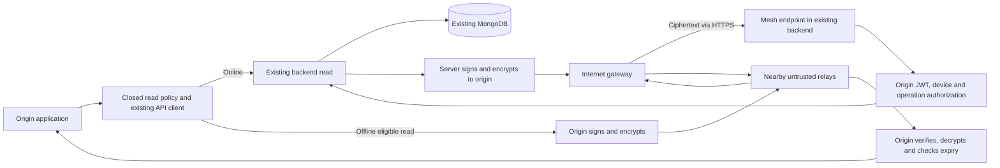

# Architecture and verified v2 protocol

**Status:** Implemented and verified protocol specification. Verified against 39 passing backend and crypto vector tests. Implementation details are documented in the [handoff](IMPLEMENTATION_HANDOFF.md). The [inventory](REPOSITORY_INVENTORY.md) defines eligible operations.

---

## 1. Components and Trust Boundaries



The existing backend is the authorized decryption boundary. Gateway TLS terminates at that backend, but TLS alone does not provide origin-to-service secrecy across intermediate peers. The payload is encrypted before entering the mesh and remains encrypted in peer queues, gateway HTTP bodies, and server response storage.

Relays choose transport routes only. They contain no patient resolvers, medical business rules, arbitrary URL forwarding, database selectors, or credential elevation. Peer session authentication protects a link; server authorization decides access.

---

## 2. Operating Modes

| Mode | Enforced Behavior |
| --- | --- |
| Mesh disabled or unsupported | Original online APIs and app flows continue; mesh is not required for startup, login, or reading online |
| Online origin | Uses existing API client and endpoint; successful online reads never route through peers |
| Offline eligible origin | Requires participation setting, current enrollment, suitable transport, closed operation, and bounded request; no fabricated success |
| Offline patient request | Rejected locally and server-side; patient requests never enter the mesh queue |
| Relay without internet | Validates bounded packet, suppresses duplicates, decrements hop budget, forwards ciphertext only |
| Internet gateway | Uploads only supported request envelope to fixed backend mesh route; returns ciphertext on reverse route |
| Network failure or expired request | Shows unavailable/expired; never converts an auth denial or mock fallback into a mesh result |

**UI Integration:** The citizen application (`NearbyHealthCentersScreen`) features `_HospitalDetailModal` wired to `MedicalDataGateway.fetchHospital()`. It displays explicit snapshot provenance ("Verified Offline Mesh Snapshot" vs "Live Online Directory Data"), delivered time, and contact phone (excluding `registeredPhone`). The hospital portal search is strictly decoupled from the mesh progress sheet.

---

## 3. Request/Response Sequence

```mermaid
sequenceDiagram
    participant O as Offline origin
    participant R as Relay
    participant G as Gateway
    participant S as Existing backend
    participant D as Existing data model
    Note over O: Created locally; not server authorized
    O->>O: Validate allowlist, encrypt token/ref, sign packet
    O->>R: Ciphertext request
    Note over R: Local acceptance only
    R->>G: Ciphertext with reduced hop budget
    G->>S: POST /api/offline-mesh/request
    S->>S: Validate signature, expiry, origin session, device and policy
    Note over S: Server authorization occurs now
    S->>D: Existing readHospital(hospitalId)
    D-->>S: Existing directory projection
    S->>S: Record snapshot; recheck access; seal and sign response
    S-->>G: Ciphertext response
    G-->>R: Reverse route
    R-->>O: Ciphertext response
    O->>O: Verify binding/signature/expiry and decrypt
    Note over O: Delivered snapshot; provenance clearly displayed
```

No peer-acceptance acknowledgement currently proves end-to-end delivery. `DELIVERED` is not inferred at the server from HTTP upload success. Legacy unauthenticated acknowledgement was disabled; a future delivery receipt would require origin authentication and a separate review.

---

## 4. Closed Operation

| Operation | Fixed Backend Read | Payload Constraints |
| --- | --- | --- |
| `READ_HOSPITAL` | Existing `GET /api/hospitals/:hospitalId` semantics via shared `readHospital()` | One hospital ID matching `^[A-Za-z0-9_-]{1,80}$`; valid origin JWT; no filter, URL, method, mutation body, file, or secondary operation |

The name being present in config `approvedOperations` denotes the code allowlist. Deployment approval and field classification are still outstanding. No wildcard or “all GET requests” rule is permitted.

---

## 5. Data Packet Envelope

The server requires exactly these 12 request fields. Unknown, missing, invalid-type, oversized, and unsupported-version packets are rejected before dispatch.

| Field | Wire Type and Constraint | Visibility / Purpose |
| --- | --- | --- |
| `v` | Integer `2` | Protocol version |
| `t` | `MEDICAL_DATA_REQUEST`; responses use `MEDICAL_DATA_RESPONSE` | Routing direction |
| `op` | `READ_HOSPITAL` | Coarse operation; visible to peers and signed |
| `rid` | Lowercase UUID v4 | Request correlation and replay binding |
| `org` | 32-character base64url device identifier | Derived from SHA-256 of device signing public key; stable/pseudonymous, not anonymous |
| `dst` | 43-character base64url HMAC destination token | Opaque backend routing binding; stable metadata |
| `iat` | Safe integer Unix seconds | Origin request creation, or server response creation |
| `exp` | Safe integer Unix seconds | Absolute expiration checked by server and origin |
| `ttl` | Integer 0–8 | Mutable remaining hop budget; not a time-to-live timestamp |
| `epk` | 43-character base64url raw X25519 ephemeral key | Key-agreement input |
| `pay` | Unpadded base64url ciphertext container, at least 28 decoded bytes | 12-byte nonce, encrypted JSON, 16-byte AEAD tag |
| `sig` | 86-character base64url Ed25519 signature | Origin signature for request; server signature for response |

Serialized envelope maximum: **96 KiB UTF-8**, below the Express default JSON body limit. Maximum request duration: **120 seconds**, with `exp > iat`, `exp > server now` and `iat <= server now + 30 seconds`. Peer forwarding stops when the hop budget reaches zero.

All immutable envelope fields are signed: `v,t,op,rid,org,dst,iat,exp,epk,pay`. Canonicalization uses lexically sorted field names, compact JSON without whitespace, and UTF-8 encoding. `ttl` is mutable and excluded from the signature.

---

## 6. Encryption and Payloads

Reuses existing X25519 key agreement, HKDF-SHA256, ChaCha20-Poly1305 AEAD, and Ed25519 signatures. The v2 encryption context strings are `swasthyatap/mesh/v2/req` and `swasthyatap/mesh/v2/resp`. Cross-language vectors (`test/vectors/mesh_v2_vectors.json`) verify interoperability between Node.js and Dart.

V2 AEAD associated data (AAD) is the canonical JSON string of `v,t,op,rid,org,dst,iat,exp`. The sender generates the ephemeral key inside the sealing routine; the packet signature binds `epk` and ciphertext. Verifying the signature is mandatory before decryption.

The decrypted request payload is strictly:
```json
{"op":"READ_HOSPITAL","ref":"HOSPITAL-ID","token":"<existing-origin-JWT>"}
```

`ref` and `token` never appear as outer routing fields, peer logs, or gateway headers. The gateway's credentials are irrelevant to this request's authorization.

A successful decrypted response contains `ok: true`, `hospital`, `rid`, `op`, `iat`, `exp`, `receivedAt`, `authorizedAt`, `snapshotAt`, and `dataUpdatedAt` when available. Not-found and access-denied results are sealed, returning a bounded error code with no sensitive text or stack trace. `Cache-Control: no-store` applies to the mesh HTTP surface.

---

## 7. Enrollment and Revocation

Enrollment is online, over the existing HTTPS API and JWT identity. The backend derives role from existing claims, verifies account existence, checks active hospital personnel membership and `isVerified`, and binds device keys to that principal.

The device proves possession of its signing key by signing UTF-8 JSON of:
```text
[2, "REGISTER_DEVICE", deviceId, signingPublicKeyBase64, agreementPublicKeyBase64, SHA256(originJWT).hex]
```

The server verifies the device ID derives from the signing key. Enrollment cannot rebind owner, swap keys, or reactivate a revoked device.

`POST /revoke-device` is a control-plane operation owned by the current authenticated principal. It sets the device to revoked and clears cached server response ciphertext for that device. Replay requests for revoked devices are denied (verified in B18).

---

## 8. Server Processing Sequence

1. Apply router-wide `OFFLINE_MESH_ENABLED` gate and structural/size/version/operation/time checks.
2. Load active registered device; verify origin signature and destination token.
3. Decrypt request; validate exact payload, operation, and scalar reference.
4. Verify origin JWT signature/expiry, device ownership, and current principal state. Rechecked on retries.
5. Bind `rid` to origin and SHA-256 of the canonical signed region. Reject collisions; never return another request's cached response.
6. Reuse unexpired ciphertext only for the exact request after re-verifying active device and server enablement; otherwise reserve request ID in the replay store.
7. Read via existing `readHospital()`, record actual access outcome and server timestamps, then recheck current access/expiry/disablement before release.
8. Seal to enrolled origin agreement key, sign, bound output size, and persist only ciphertext plus necessary metadata.
9. Return ciphertext. Intermediary transport receives no decrypted read results.

---

## 9. HTTP Surface and Compatibility

All paths below are under `/api/offline-mesh`.

| Endpoint | Enforced Behavior |
| --- | --- |
| `GET /config` | Public operational config; available while disabled; no sensitive data |
| `POST /register-device` | Strict JWT + current principal + key proof; requires server enabled flag |
| `POST /request` | Fixed ciphertext ingress; authenticates origin from encrypted request, not gateway |
| `POST /revoke-device` | Authenticated owner action; revokes device and clears response cache |
| `GET /response/:requestId` | Legacy route returns 410 when enabled, 503 when disabled |
| `POST /response-ack` | Legacy unauthenticated acknowledgement removed; returns 410 / 503 |
| `GET /status/:requestId` | Legacy activity lookup removed; returns 410 / 503 |

Transport errors are generic: `INVALID_PACKET`, `ACCESS_DENIED`, `MESH_DISABLED`, `DUPLICATE_REQUEST`, `REQUEST_PENDING`, `REQUEST_EXPIRED`, `RESPONSE_UNAVAILABLE`, `RATE_LIMITED`, `MESH_UNAVAILABLE`, or `UNSUPPORTED_OPERATION`.
