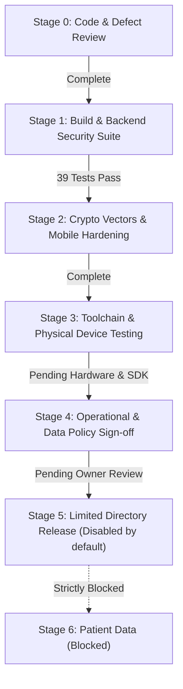

# Change impact, rollout and rollback

**Status:** Implementation verified in automated backend tests (39 tests pass). Production mesh remains disabled (`OFFLINE_MESH_ENABLED=false`). No deployment has been performed. See [handoff](IMPLEMENTATION_HANDOFF.md) and [test plan](TEST_AND_ACCEPTANCE_PLAN.md).

---

## 1. Compatibility Boundary

Preserve the names, endpoints, and response contracts of existing online hospital, citizen, auth, report, prescription, and NFC APIs. Zero changes have been made to business schemas, authentication issuance, or online routing. The extracted `readHospital()` function produces identical responses for both the online route (`GET /api/hospitals/:hospitalId`) and the mesh dispatcher.

The **mesh protocol has upgraded incompatibly** from the initial v1 prototype to the verified v2 specification:
- v2 requires an exact 12-field envelope, canonical JSON, HKDF info contexts (`swasthyatap/mesh/v2/req`, `swasthyatap/mesh/v2/resp`), and Ed25519 signatures.
- v1 data packets and legacy poll/status/ack routes fail closed, returning HTTP 410 `UNSUPPORTED_OPERATION` when enabled (verified in B21).
- Existing online application workflows are unaffected by this protocol versioning.

---

## 2. Change Impact by Component

| Component / Files | Implemented Changes | Compatibility & Test Evidence | Rollback Strategy |
| --- | --- | --- | --- |
| `backend/src/routes/hospitals.js` | Extracted `readHospital()` query shared by online route and mesh dispatcher | Response shape and query semantics identical; verified in B01 | Mesh can be disabled without touching online route |
| `backend/src/routes/offlineMesh.js`, `meshValidation.js` | Closed dispatcher for `READ_HOSPITAL`; strict origin JWT validation; replay protection; sealed errors | Verified in B01–B26; legacy routes return 410 (B21) | Disable via server flag; online APIs unaffected |
| `backend/src/services/meshAccess.js` | Strict JWT claim verification; rejects demo tokens; verifies personnel, hospital, and citizen existence | Reuses existing secret/library; verified in B06–B10 | Disable mesh; no auth service teardown required |
| `backend/src/services/meshCrypto.js` | Canonical JSON, HKDF contexts, ChaCha20-Poly1305, Ed25519 signing | Verified against cross-language golden vectors (C01–C08) | Disable mesh; existing online crypto unaffected |
| `backend/src/models/OfflineMeshRequest.js` | Optional replay digest, `authorizedAt`, `snapshotAt` fields | Reuses existing unique index on `requestId`; verified in B13–B16, B24 | Leave optional fields unused; no schema rollback needed |
| `lib/services/medical_data_gateway.dart`, `api_service.dart` | Removed legacy poll/ack calls; wired `fetchHospital()` with progress callbacks; fixed imports | Preserves online client methods; verified in mobile code | Keep compile flag disabled |
| `mesh_read_policy.dart`, `offline_packet.dart`, `mesh_config.dart` | Closed enum, regex grammar, 24-hr runtime lease check (`isRuntimeLeaseValid`) | Verified in C01–C08, M01–M03 | Default build flag `false` keeps mesh inactive |
| `offline_mesh_manager.dart`, `offline_response_manager.dart` | Origin JWT sealing; response expiry check; fail-safe teardown wrapping cleanup in try-catch | Verified in F21; decrypted results tagged `source: 'mesh'` | Mesh manager disabled by default |
| `peer_manager.dart`, `relay_manager.dart` | Discovered peer connection triggers (F10); metered connection checks (F09); packet-type cache keys (F04) | Verified in mobile code; hop budget decrement enforced | Turn off peer participation in settings |
| `lib/main.dart`, `nearby_health_centers_screen.dart` | Fixed imports; added `_HospitalDetailModal` displaying snapshot provenance and suppressing `registeredPhone` | Non-blocking startup; online workflows preserved | Feature flag gates UI entry point |

---

## 3. Configuration & Feature Flags

| Configuration Setting | Runtime Usage | Production Constraint |
| --- | --- | --- |
| Server `OFFLINE_MESH_ENABLED` | Gating middleware across all mesh endpoints except `GET /config` | **Set to `false`** in production until all release gates pass |
| Mobile `OFFLINE_MESH_ENABLED` | Compile-time Dart define; gates mesh provider bootstrap | **Defaults to `false`**; online app runs independently |
| Participation Consent | Stored in `mesh_consent` | Requires explicit user toggle in settings |
| Runtime Configuration Lease | 24-hour lease verified via `MeshConfig.isRuntimeLeaseValid` | Stale configs (>24h) deactivate mesh until refreshed |
| `JWT_SECRET` | Existing auth signing and verification secret | Reused directly; never changed or exposed |
| `MESH_SERVER_SECRET` | HMAC key for destination tokens and replay digests | Server-side only; protected in deployment secret manager |
| `MESH_SERVER_X25519_PRIVATE` | Server request decryption key | Kept in secret manager; never checked into repository |
| `MESH_SERVER_ED25519_PRIVATE` | Server response signing key | Kept in secret manager; never checked into repository |

---

## 4. Release Stages & Gates

| Stage | Milestones & Criteria | Current Status |
| --- | --- | --- |
| **0. Preserve & Review** | Review working tree diff; preserve uncommitted user changes; confirm scope | **COMPLETED** |
| **1. Build & Backend Security** | Resolve F01 imports; implement B01–B26 in `meshReadOnly.test.js`; verify zero business writes | **COMPLETED:** 26/26 backend security tests pass |
| **2. Crypto & Lifecycle** | Generate golden vectors; verify C01–C08 in `meshVectors.test.js`; resolve F04, F08, F09, F10, F16, F20, F21 | **COMPLETED:** 8/8 crypto vector tests pass (39 tests total) |
| **3. Toolchain & Physical Testing** | Run `flutter analyze` and `flutter test test/offline_mesh/`; execute 3-device Android Nearby scenario (M05) | **PENDING:** Requires Flutter SDK on host/CI and physical Android hardware |
| **4. Operational & Policy Sign-off** | F15 resolved (registeredPhone excluded); verify secret custody and deployment readiness | **PENDING:** Requires operations sign-off |
| **5. Limited Directory Release** | Enable feature flag in controlled environment for directory lookup only | **GATED:** Disabled until stages 3 and 4 pass |
| **6. Patient Data Reconsideration** | Re-evaluate only if an authoritative patient consent/access policy is created | **BLOCKED:** Excluded from scope; no consent policy exists |

---

## 5. Disablement and Incident Response

1. **Immediate Server Disablement:** Set `OFFLINE_MESH_ENABLED=false` on the backend. Verified in B20: all mesh endpoints return 503 `MESH_DISABLED` immediately (except public `GET /config` which reports disabled status).
2. **Online Workflow Preservation:** Disabling mesh has zero impact on ordinary online citizen/hospital login, directory queries, or profile reads.
3. **Mobile Client Disablement:** Toggle off participation in settings (`MeshSettingsTile`) or compile with `OFFLINE_MESH_ENABLED=false`. All peer discovery, connections, and queuing stop immediately.
4. **Key Compromise Response:** If server private keys are compromised, rotate `MESH_SERVER_X25519_PRIVATE` and `MESH_SERVER_ED25519_PRIVATE` in the server secret manager. Clients re-fetch public keys on next online enrollment over HTTPS.
5. **No Data Recall Claim:** Decrypted plaintext already displayed on a device cannot be recalled remotely. Disabling the backend prevents new requests and cache release.

---

## 6. Rollback Procedures

- **Working Tree:** All working tree changes are tracked and verified. If rollback of mesh code is ever requested by the user, the working tree can be reverted to the base commit `5447776d0d846e899503bdbe97178c534829a0c0`.
- **Database:** Zero schema modifications were made to `Hospital` or `Citizen` collections. The optional fields on `OfflineMeshRequest` (`requestDigest`, `authorizedAt`, `snapshotAt`) require no migration or cleanup; records expire automatically via the existing 900-second TTL index.
- **Client State:** If a client needs mesh state reset, toggling mesh off invokes `OfflineMeshManager.stop()`, which safely clears private keys from secure storage and transit queues from SQLite.
